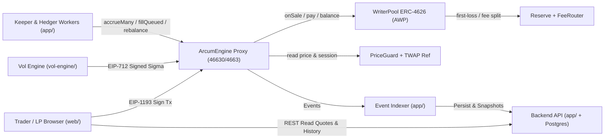

# Arcum — Engineering Audit Update, UI Maximization & Integration Blueprint

**Tanggal Review:** 10 November 2026  
**Repository:** `https://github.com/wealthy-org/arcum` (commit `b950f4b`)  
**Live Preview:** `https://arcum-f2tc.vercel.app/`  
**Referensi Spesifikasi:** `ARCUM_ROBINHOOD_DEV_BRIEF.md` & `ARCUM_CONTRACTS_REFERENCE_OVERVIEW.md`

---

## Ringkasan Eksekutif & Arah Engineering

Secara fondasi struktur, tim sudah membangun kerangka monorepo yang rapi (`contracts/`, `app/`, `vol-engine/`, `web/`, `docs/`), mendokumentasikan parameter risiko, menyusun *privilege map* serta *runbooks*, dan membawa arah visual Light/Dark + komponen kartu *Doppelrand* hingga bisa diakses live di Vercel.

Tahap berikutnya adalah menjembatani **gap antara prototipe/simulasi lokal menjadi sistem terintegrasi penuh**:
1. Menyempurnakan integrasi on-chain di sisi smart contract agar seluruh modul saling terhubung tanpa mock EOA.
2. Menghubungkan API, indexer, keeper, hedger, dan volatility engine ke RPC & database nyata (zero static/hardcoded telemetry).
3. Memaksimalkan kualitas tampilan frontend (responsivitas mobile `390px`, kontras Light/Dark, sinkronisasi interaksi UI, penutupan route kosong) serta memasang koneksi Web3 wallet yang riil.

Dokumen ini memetakan **temuan teknis objektif**, **kondisi yang seharusnya**, **alur integrasi step-by-step**, serta **output akhir yang diharapkan**.

---

## 1. Status Eksekusi Build & Test Saat Ini (`repo/` commit `b950f4b`)

| Komponen | Hasil Pengecekan Lapangan | Catatan Teknis |
|---|---|---|
| `contracts/` | `forge test` gagal saat fresh clone; setelah `OpenZeppelin v5.1.0` di-install manual (uji terisolasi), 28 unit test di 9 suite pass | `.gitmodules` belum ter-commit sehingga `lib/openzeppelin-contracts` & `lib/openzeppelin-contracts-upgradeable` kosong saat clone baru. Unit test memakai mock pool EOA. |
| `app/` | `bun install --frozen-lockfile`, `tsc --noEmit`, dan `bun test` (`20 pass / 0 fail`) berjalan bersih | Seluruh test memvalidasi kalkulasi & struktur data in-memory, belum menguji koneksi RPC/DB. |
| `vol-engine/` | `uv sync --all-extras && uv run pytest -v` (`8 passed`) berjalan bersih | `pytest` berada di `optional-dependencies.dev` (perlu `--all-extras`). `api/index.py` aktif di Vercel. |
| `web/` | `npm ci` gagal karena memakai `bun.lock` (tanpa `package-lock.json`); `bun install && bun run check && bun run build` sukses (`1.58s`) | Output bundle produksi clean (`47.76 kB` CSS, `294.75 kB` JS). |
| Live Vercel | HTTP `200 OK` untuk UI & endpoint `/v1/health`, `/v1/config`, `/v1/pool`, `/v1/stocks` | Pemeriksaan browser CDP & screenshot menemukan beberapa tombol route mengarah ke view kosong, inkonsistensi kalkulator/UI, dan overflow di mobile viewport `390x844`. |

---

## 2. Peta Temuan & Target Kondisi yang Seharusnya

### Bagian A — Smart Contracts & Matematika On-Chain

| Area & File | Kondisi Saat Ini | Harusnya Seperti Apa |
|---|---|---|
| **Reproducibility Submodule** `contracts/lib/*` | `.gitmodules` tidak ada; folder `openzeppelin-contracts` & `openzeppelin-contracts-upgradeable` berupa gitlink kosong. | Tambahkan `.gitmodules` atau kelola via Foundry dependencies yang valid agar `git clone --recursive` dan `forge build && forge test` langsung berjalan di mesin manapun. |
| **Fixed-Point Math & Differential Parity** `contracts/src/libs/FixedMath.sol` (`L72-L88`) `scripts/differential_test.py` | Pada `wadExp(x)`, `k` masih berskala WAD sehingga `r = x - (k * ln2) / WAD` menjadi `~0`, lalu shift `sum >> uint256((-k)/SIGNED_WAD)` membuang bagian pecahan. Akibatnya harga Solidity melenceng **~4.4%–4.5%** dari TS/Python (mis. NVDA Put `S=142.5, K=145`: Py/TS `$3.0603` vs Sol `$3.1976`). Selain itu `differential_test.py` belum menguji output Solidity. | Gunakan fixed-point exponential/pow dari baseline Sourcify Lemniscate yang terverifikasi Exact Match (`FixedMath.sol`), atau perbaiki pembagian skala `k` agar sisa pecahan `r` dihitung oleh deret Taylor. Perluas `differential_test.py` agar mengeksekusi kontrak Solidity via `forge`/`cast` sehingga selisih lintas Solidity–TS–Python terbukti `< 1e-12`. |
| **Engine Accrual & `OptionToken` Hooks** `contracts/src/ArcumEngine.sol` (`L198-L202`) `contracts/src/OptionToken.sol` | `accrue()` dan `accrueMany()` masih kosong (no-op); `OptionToken` belum meng-override `_update()` untuk memicu accrual sebelum transfer/mint/burn. | Kembalikan logika `Funding.accrueNorm` di `accrue()` untuk memperbarui `norm` di `SeriesRegistry` secara persisten, serta tambahkan hook `engine.accrue(seriesId)` di `OptionToken._update()` sebelum saldo berubah. |
| **Integrasi `ArcumEngine` ↔ `WriterPool` ↔ `FeeRouter`** `contracts/src/ArcumEngine.sol` (`L72-L180`) `contracts/src/WriterPool.sol` (`L169, L233`) | Engine memanggil `USDG.safeTransferFrom(pool, ...)` saat `sell()` dan tidak memanggil `pool.onSale()` / `pool.pay()` / `FeeRouter`, serta tidak menegakkan cap `35% / 8% / 40k / 25k` di `buy()`. Unit test memakai dummy EOA alih-alih `WriterPool` sungguhan. Token share di `WriterPool` masih bernama `"Lemniscate Writer Pool" / "LWP"`. | Sambungkan transaksi `buy` ke `WriterPool.onSale()`, `sell` ke `WriterPool.pay()`, dan terapkan pengecekan cap/stress budget di jalur `buy()`. Rename share `WriterPool` menjadi `"Arcum Writer Pool" / "AWP"`. Lengkapi integration test yang men-deploy `ArcumEngine` + `WriterPool` + `Reserve` + `FeeRouter` bersamaan (tanpa EOA mock). |
| **Kelengkapan Blueprint Sourcify** `contracts/src/` vs `ARCUM_CONTRACTS_REFERENCE_OVERVIEW.md` | Baru 14 top-level contract + 8 libs; `contracts/src/engine/*` (Storage ERC-7201, UUPS Engine, `EngineTradeLib`, `EngineSellLib`, `EngineMarkLib`, `EngineOpsLib`, `EngineViewLib`), `EngineHelper.sol`, `OptionTokenFactory.sol`, `VolOracle.sol`, dan `NyseCalendar.sol` belum ada. | Disarankan mengekstrak & memakai utuh seluruh modul Sourcify (44 file protokol) sebagai basis utama, lalu lakukan sanitasi brand (`Lemniscate` → `Arcum`, `eNVDA` → `aNVDA`, `"ArcumVolOracle"`, `"arcum.storage.Engine"`). Jauh lebih aman dan cepat daripada menulis ulang `ArcumEngine` secara parsial. |
| **Volatility & Price Guard On-Chain** `contracts/src/ArcumEngine.sol` (`L77, L237`) `contracts/src/PriceGuard.sol` (`L15-L75`) | IV di-hardcode `5000` (50%) karena `VolOracle.sol` belum ada; `PriceGuard` baru memakai `_mockPrices` dari owner, belum membaca Chainlink/Pyth maupun membandingkan `UniswapV3TwapReference`. `AgentRouter` memanggil 4 fungsi Engine (`shieldList`, `ticketCount`, `syncSeries`, `sellFor`) yang belum tersedia di `ArcumEngine.sol`, serta `shield()` belum memeriksa saldo stock token user. | Implementasikan `VolOracle.sol` (penerima payload EIP-712 dari `vol-engine`), sambungkan ke `quote()` & `netGreeks()`. Pada `PriceGuard.sol`, aktifkan pembacaan feed real (untuk testnet `46630` bisa gunakan feed aggregator testnet/mock aggregator terstandar dengan check `updatedAt`, staleness, multiplier, dan deviasi TWAP). Lengkapi fungsi Engine agar `AgentRouter.sellFor()` dan `AgentRouter.shieldFor()` berjalan penuh dan diuji di `AgentRouter.t.sol`. |

---

### Bagian B — Manifest Deployment, Keamanan & Pemisahan Identitas Upstream

| Area & File | Kondisi Saat Ini | Harusnya Seperti Apa |
|---|---|---|
| **Address Referensi Lemniscate di Manifest** `deployments/4663.json` `web/src/data/protocol.ts` (`L12-L19`) | Seluruh address (`engineProxy`, `writerPoolProxy`, `agentRouter`, `reserve`, `feeRouter`, `timelock`) menunjuk langsung ke deployment Lemniscate (`0x1C1f...`, `0x67fF...`, dll.). | Simpan address Lemniscate hanya di file arsip/referensi (mis. `deployments/upstream-reference.json`). `deployments/46630.json` (Testnet) dan `deployments/4663.json` (Mainnet) hanya boleh berisi kontrak milik **Arcum** hasil broadcast deployer sendiri. |
| **Placeholder Address & ABI di UI** `web/src/pages/ContractsPage.tsx` (`L35`) `web/src/pages/ExitPage.tsx` (`L33-L34`) | `UniswapV3TwapReference` menampilkan address placeholder `0x3333...9999` berlabel *Sourcify Exact Match*. Di `ExitPage.tsx`, panduan menyebut `requestWithdrawal()` dan `claimWithdrawal()`. | Pastikan setiap address di `ContractsPage` terambil otomatis dari manifest aktif (`46630` / `4663`) lengkap dengan status verifikasi riil. Koreksi fungsi panduan di `ExitPage.tsx` agar sesuai ABI `WriterPool.sol`: **`requestWithdraw(uint256 shares)`** dan **`claim(uint256 ticket)`**. |

---

### Bagian C — Backend Services, Indexer, Database & Volatility Engine

| Area & File | Kondisi Saat Ini | Harusnya Seperti Apa |
|---|---|---|
| **API Telemetry & Vercel Serverless** `app/src/api/server.ts` `vol-engine/api/index.py` | Endpoint `/v1/health`, `/v1/pool`, dan `/v1/stocks` mengembalikan JSON statis hardcoded (`navUsdg: 2500000`, `aprPct: 18.4`, `lastBlock: 18942109`, key `0x1111...`). | Hubungkan API dengan `viem` RPC client ke Robinhood Chain (`46630` untuk staging/testnet, `4663` untuk produksi) untuk membaca NAV, cash, open liability, series aktif, serta session status secara real-time. Jika pool baru masih `0 USDG`, tampilkan nilai nyata + label status yang jujur (mis. `Testnet` / `Pre-Seed` / `Demo Simulation`). |
| **Database & Workers Terpisah** `app/src/indexer/`, `keeper/`, `hedger/`, `mcp/`, `aa/` | Baru berbentuk class in-memory; belum memiliki skema Postgres/TimescaleDB, cursor RPC log persistence, endpoint `/v1/quote` (unsigned calldata), `/v1/accounts`, maupun MCP server stdio/HTTP. | Sediakan skema Postgres + migrasi untuk event indexer (`Bought`, `Sold`, `ShieldBought`, `QueuedSell`), norm history, dan receipts. Jalankan `keeper` (accrual & fill queue), `hedger` (Spot rebalance via `WriterPool`), dan `vol-engine` sebagai worker background masing-masing dengan private key berbeda & minim hak akses. |

---

### Bagian D — Maksimalin Tampilan Visual Craft, Layout & Interaksi Web3 (`web/`)

Bagian ini disusun berdasarkan inspeksi visual langsung terhadap 10+ screenshot lintas rute (`https://arcum-f2tc.vercel.app/` di Light Mode, Dark Mode, dan Mobile `390x844`), **murni untuk memaksimalkan tampilannya agar setara terminal finansial institusional kelas atas**:

1. **Restrukturisasi Navigasi Workspace & Penghapusan Pill Bar 7-Tab Mengambang (`web/src/pages/DashboardPage.tsx` `L299-L348`, `web/src/components/Navbar.tsx`, `web/src/components/StockTickerBar.tsx`, `web/src/App.tsx`)**
   - *Temuan Visual & UX:*
     - Saat membuka terminal trade, user menghadapi **4 lapis bar horizontal bertumpuk** sebelum sampai ke daftar strike: (1) Global Navbar (`Trade | Markets | Docs | Contracts | Learn`), (2) `StockTickerBar` (`NVDA | TSLA | SPY | QQQ | AAPL`), (3) pill bar sub-navigasi berisi **7 tab campuran** (`Trade Options`, `Positions 2`, `1-Click Shield`, `Writer Pool`, `AI Agents`, `Activity`, `Settings`) plus pill **`Underlying: NVDA $142.50`** di sisi kanan (`L302-L347`), serta (4) bar `Up (Call) / Down (Put)` dan `Funding Speed`.
     - Wadah pill 7-tab menggunakan `rounded-xl overflow-x-auto scrollbar-none`: seluruh menu primer (`Trade Options`, `Positions`, `Writer Pool`) hingga menu utilitas (`AI Agents`, `Activity`, `Settings`) disejajarkan memanjang dalam satu kapsul mengambang yang boros ruang vertikal dan rentan terpotong tanpa penanda scroll di viewport laptop/tablet yang lebih sempit.
     - Pill **`Underlying: NVDA $142.50`** di pojok kanan baris tab mengulang aset yang sudah disorot tepat di atasnya pada `StockTickerBar`, sehingga terasa penuh namun tidak menambah fungsi baru.
     - Secara arsitektur informasi, menu bar paling atas (`Trade`, `Markets`) dan 7 tab di bawahnya saling tumpang-tindih secara konseptual — user tidak mendapat petunjuk visual yang tegas mana navigasi utama aplikasi dan mana konteks pasar aktif.
   - *Harusnya (Pilih salah satu pola layout yang lebih reliable — direkomendasikan **Opsi A**):*
     - **Opsi A (Direkomendasikan — Workspace Left Sidebar Rail bergaya Terminal Finansial):**
       - Pisahkan navigasi halaman marketing/landing dari **App Workspace**. Di dalam Workspace, pindahkan navigasi fitur ke **Left Sidebar tetap (`220px–240px`)** yang dikelompokkan rapi sesuai alur kerja:
         - *Core Trading & Vault:* `Overview`, `Trade Options`, `1-Click Shield`, `Positions (2)`, `Writer Pool`
         - *Automation & Logs:* `AI Agents`, `Activity`
         - *Docs & System:* `Docs`, `Contracts`, `Learn`, `Settings`, `Exit Guide`
         - *Footer Sidebar:* `Testnet / Mainnet` switch, Chain badge, Theme switch, dan Wallet button (`0x71C8...a49B`).
       - Bagian atas area utama Workspace cukup berisi **1 baris Market/Asset Context Strip** (`NVDA`, `TSLA`, `SPY`, `QQQ`, `AAPL` lengkap dengan Spot, `%`, dan `IV`), sehingga daftar Strike & Order Summary langsung naik penuh *above the fold*, nol redundansi label `Underlying`, dan nol risiko tab horizontal terpotong.
     - **Opsi B (Alternatif Ringkas jika Tetap Memakai Top Navigation):**
       - Hapus baris kapsul 7-tab (`DashboardPage.tsx` `L299-L348`) beserta pill `Underlying` di kanannya.
       - Ratakan navigasi menjadi **1 Top Navbar tunggal** (`Trade`, `Shield`, `Writer Pool`, `Positions [2]`, `More ▾` untuk `AI Agents / Activity / Docs / Contracts / Settings`), dan gunakan tab garis bawah (`border-b`) full-width *hanya* bila sebuah modul memang punya sub-halaman internal (mis. `Open Positions | Queued Sells | History`).

2. **Perbaikan Proporsi Grid & Penghilangan "Card Ngambang" (`DashboardPage.tsx`, `LandingPage.tsx`)**
   - *Temuan Visual (`Trade Options`):* Kolom kiri (`lg:col-span-2`) berakhir tepat di bawah box kecil *“How holding cost works in Arcum”* (±480px tinggi), menyisakan **ruang kosong lebar di kiri bawah**, sementara di kolom kanan `Order Summary` + `What-If PnL Simulator` ditumpuk berdua sehingga kotak What-If di kanan bawah tampak *mengambang* sendirian dengan judul terjepit 2 baris (*“What-If PnL / Simulator”* + *“Simulates Norm / Decay”*).
   - *Harusnya:* Pindahkan **What-If PnL Simulator** ke **kolom kiri (`lg:col-span-2`)** tepat di bawah `Select Strike Price` dan lengkapi dengan grafik kurva SVG **Payoff vs Continuous Norm Decay** agar lebarnya lega dan tinggi kolom kiri–kanan seimbang. Biarkan kolom kanan fokus pada **Order Summary Ticket (sticky)** + ringkasan kapasitas pool / max exposure.
   - *Temuan Visual (`LandingPage Hero`):* Kolom kiri Hero berhenti lebih tinggi daripada kartu terminal sebelah kanan, sehingga di bawah alamat kontrak tersisa area kosong. Tambahkan strip **3 Core Anchors** yang bersih (`3 bps Base Fee`, `USDG 6-dp Settlement`, `0 Margin Liquidation`) sejajar dengan bagian bawah kartu kanan agar keseimbangan visual (*visual weight*) rata kanan-kiri.

3. **Eliminasi Elemen Gradient/Neon "AI Slop" Menuju Estetika Institusional Clean (`index.css`, `LandingPage.tsx`, `DashboardPage.tsx`, `Navbar.tsx`)**
   - *Temuan Visual:*
     - Kata **`flow`** pada *"Built for the flow of everlasting options"* dan *"Go with the flow"* memakai `text-prism` (gradasi pelangi 4 warna hijau–cyan–biru–ungu yang bergerak). Ini terasa artifisial dan mengurangi wibawa finansial.
     - Tombol CTA utama (`Launch App`, `Connect Wallet`, `Trade Up Calls`, `Buy Up (Call) Option`, `Approve & Deposit USDG`, `Execute 1-Click Shield`, `Download Offline HTML`) semuanya memakai `bg-gradient-to-r from-arcum-cyan to-arcum-cobalt` (atau emerald–teal) + blur glow shadow berwarna terang + pola tombol *button-in-button* (lingkaran ikon di dalam pill hijau).
     - Pill badge di atas judul (*"Automated Stock Token Downside Floor"*, *"Owner-Authorized On-Chain Delegation"*, *"Robinhood Chain Ecosystem"*) berulang di beberapa halaman.
     - Bayangan `shadow-2xl` pada kartu putih di Light Mode (`DocsPage`, `ContractsPage`, `ExitPage`) menyebar terlalu lebar sehingga terlihat agak "kotor" di atas canvas `#F8FAFC`.
   - *Harusnya:*
     - Ganti `text-prism` dengan highlight tipografi **solid berkarakter** (mis. accent solid cobalt `#2563EB` di Light / `#38BDF8` di Dark, atau font *serif italic* tipis agar fokus pembaca langsung ke kalimat tanpa distraksi warna-warni).
     - Ganti tombol gradient-glow menjadi **solid high-contrast fills** dengan transisi hover tegas (mis. `#0F172A` / `#2563EB` di Light Mode, crisp `#F8FAFC` / `#1D4ED8` di Dark Mode; tombol Buy/Sell memakai emerald `#059669` & rose `#E11D48` solid clean berbentuk `rounded-xl` tanpa lingkaran melayang di dalam pill).
     - Terapkan sistem permukaan **border-first crisp** ala Stripe/Linear/Vercel: di Light Mode pakai `border border-slate-200/90 shadow-[0_1px_2px_rgba(15,23,42,0.04)] bg-white` (hapus `shadow-2xl` yang menyebar dan kabut radial background `blur-[140px]`).
     - Ganti badge pill di atas heading menjadi eyebrow text uppercase monospace tipis agar seragam di seluruh rute.

4. **Perbaikan Kontras Light Mode (`index.css`, `DashboardPage.tsx`, `LandingPage.tsx`, `WriterPool`)**
   - *Temuan Visual:*
     - **Bug Hover Menghilang (`33 titik hover:text-white` di 9 file):** Pada `web/src/index.css` (`L107-L115`), override `html:not(.dark)` hanya menangani `.text-white`, **belum meng-override `.hover:text-white:hover` dan `.hover:border-white/20:hover`**. Akibatnya di Light Mode, saat kursor diarahkan ke tombol `Navbar` (*Markets*, *Docs*, *Contracts*, *Learn*, *Testnet/Mainnet*), `StockTickerBar`, tab `DashboardPage`, tombol *Select* strike, maupun sidebar `DocsPage`, background berubah menjadi abu-abu tipis sementara teksnya ikut berubah menjadi **`#FFFFFF`** dan lenyap tidak terbaca.
     - Di Light Mode default, nilai **`Est. Daily Decay`** (`-$0.080`, `-$0.542`, `-$0.560`, `-$13.712 / day`) dan teks **`24 Hours`** di `Writer Pool` menggunakan **`text-amber-400` (`#FBBF24`) di atas putih (`#FFFFFF`)** — kontrasnya sangat rendah (~1.6:1) sehingga nyaris tidak terbaca.
     - Teks **`Verified Engine:`** di Hero menggunakan `text-white/40` sehingga menghilang dari layar terang dan menyisakan address yang terkesan menggantung.
     - Tombol sekunder (`Create Withdrawal Ticket`, `Trade Down Puts`, `Explore Chains`, dan state aktif `Daily (τ=1d)` vs `Weekly (τ=7d)`) masih memakai `border-white/10 hover:border-white/20` dan warna teks yang kontrasnya terlalu tipis saat putih bertemu putih.
   - *Harusnya:*
     - Ubah seluruh `hover:text-white` pada elemen latar terang/transparan di `Navbar.tsx`, `StockTickerBar.tsx`, `DashboardPage.tsx`, `LandingPage.tsx`, `DocsPage.tsx`, `ContractsPage.tsx`, `MobileBottomNav.tsx`, dan `PwaInstallBanner.tsx` menjadi **`hover:text-arcum-text`** (dan tambahkan aturan fallback `html:not(.dark) .hover\:text-white:hover` di `index.css` terkecuali tombol ber-background solid gelap/merah seperti `hover:bg-arcum-down`).
     - Ganti `text-amber-400` menjadi `text-amber-700 dark:text-amber-400` (`#B45309`), ganti semua `text-white/*` menjadi `text-arcum-muted` / `text-slate-600 dark:text-slate-400`, serta pertegas `border-slate-300 hover:border-slate-400` pada tombol sekunder & state aktif di Light Mode.

5. **Presisi Layout Desktop (`StockTickerBar`) & Mobile `390px` (`Navbar.tsx`, `PwaInstallBanner.tsx`, `MobileBottomNav.tsx`)**
   - *Temuan Visual Desktop (`1440px`):* `StockTickerBar` memotong sisi kanan `AAPL` dan menyisakan jarak nanggung ke batas kanan scrollbar meski hanya ada 5 item. Gunakan grid/flex full-width (`justify-between`) pada viewport desktop agar NVDA, TSLA, SPY, QQQ, dan AAPL tertata rata penuh.
   - *Temuan Visual `LearnPage`:* Input `Spot Price (S)` memunculkan koma locale (`142,5`), sedangkan dropdown `<select>` (*Daily 86,400s*) memakai panah native browser yang mepet kanan. Gunakan custom SVG chevron + padding `pr-8` dan pastikan format numerik konsisten.
   - *Temuan Visual Mobile (`390x844`):* Tombol wallet `0x71C8...` + menu hamburger, tombol `Install` PWA Banner, baris address Hero `0x1C1f...`, dan kolom ke-5 (`More`) pada `MobileBottomNav` terpotong keluar batas kanan layar.
   - *Harusnya:* Pasang `overflow-x-hidden` pada root wrapper, tambahkan `min-w-0` + `truncate`/`break-all` pada address/teks di dalam grid/flex, ringkas ukuran pill wallet/navbar untuk `< 640px`, dan atur `MobileBottomNav` `grid-cols-5 px-1` agar kelima tombol masuk utuh dalam `100vw`.

6. **Penutupan Route Kosong, Sinkronisasi Kontrol Dashboard & Rumus Decay (`App.tsx`, `Footer.tsx`, `ProductsPage.tsx`, `pricing.ts`)**
   - *Tutup Route Kosong:* Daftarkan handler untuk **`markets`**, **`writers`**, dan **`protocol`** di `App.tsx` (tombol Hero **"Explore Chains"** dan link Footer **"Pools"**, **"Writer Pool Yield"**, **"Protocol Analytics"** saat ini mengosongkan `<main>`). Gunakan URL routing (`history.pushState` / `popstate`) agar refresh & Back/Forward browser berfungsi. Arahkan tombol `ProductsPage.tsx` langsung ke tab spesifik (`dashboard` tab `shield` / `pool`).
   - *Strike & ATM Tunggal:* Snap `selectedStrike` ke strike valid terdekat saat aset dipilih/berganti, dan pastikan badge **`ATM` hanya menyala pada 1 strike terdekat dengan spot** (bukan pada `$140` dan `$145` sekaligus).
   - *Kontrol Interaktif Aktif:* Sambungkan slider **1-Click Shield** ke React state (`shieldPctBelow`) untuk menghitung strike & estimasi premi secara dinamis via `quoteOption()`, aktifkan handler **Slippage Tolerance** di Settings, serta hubungkan **Network Switcher (`46630`/`4663`)** ke config global RPC, Explorer, dan manifest address.
   - *Sinkronisasi Rumus Simulator:* Di `web/src/utils/pricing.ts` (`L123`), ganti `0.5 / tau` menjadi **`timeValue / (markPrice * tau)`** agar sama persis dengan `contracts/src/libs/Funding.sol` (mencegah proyeksi decay melompat tidak wajar ke `-77.7%`).

7. **Integrasi Web3 Wallet Nyata & Kejujuran Data Provenance**
   - Ganti boolean toggle `walletConnected` (`0x71C8...a49B`) dengan `wagmi` + `viem` (EIP-1193), tampilkan state **Disconnected / Wrong Network / Insufficient USDG / Approve / Submit / Confirmed Tx Hash**, hilangkan label statis `$2.5M NAV / 18.4% APR / Audited` bila masih simulasi, dan selaraskan ticker (`NVDA, TSLA, SPY, QQQ, AAPL`) serta RPC resmi di seluruh halaman docs.

---

## 3. Output yang Diharapkan Setelah Perbaikan (Definition of Done)

Saat seluruh item di atas selesai diintegrasikan, hasil akhir yang harus bisa dibuktikan adalah:

1. **Test Suite Jujur & Reproducible:**
   - `git clone --recursive` → `cd contracts && forge build && forge test` langsung lulus tanpa install manual, mencakup test integrasi penuh `ArcumEngine ↔ WriterPool ↔ FeeRouter ↔ Reserve ↔ AgentRouter`.
   - `scripts/differential_test.py` memanggil Solidity secara nyata dan mencatat deviasi Solidity vs TS vs Python pada batas presisi WAD (`< 1e-6` atau sesuai rounding USDG 6 desimal).
2. **Testnet `46630` Hidup & Terverifikasi:**
   - Kontrak milik Arcum (Engine, WriterPool `AWP`, SeriesRegistry, PriceGuard, VolOracle, Reserve, FeeRouter, AgentRouter) ter-deploy independen di Robinhood Chain Testnet (`46630`), terverifikasi di Blockscout/Sourcify, dan tercatat lengkap di `deployments/46630.json`.
   - Tidak ada satupun address kontrak Lemniscate yang dipakai oleh app produksi Arcum.
3. **Backend API & Telemetry Akurat:**
   - `/v1/pool`, `/v1/stocks`, `/v1/health`, `/v1/chains` membaca state kontrak on-chain dan database indexer. Nilai NAV, utilization, open positions, dan series norm berasal dari chain, bukan angka statis.
4. **Tampilan Web & UX Maksimal (Desktop + Mobile):**
   - Tidak ada halaman kosong di tombol Hero/Navbar/Footer; semua tombol dan slider (`Trade`, `Shield`, `Pool`, `Settings`, `Network Switch`) responsif dan merubah state nyata.
   - Light Mode kontras tinggi (zero text putih samar) dan Mobile `390px` rapi tanpa horizontal overflow.
   - User dapat menyambungkan MetaMask/Rabby sungguhan, melakukan **Approve USDG → Buy Option → Lihat Posisi & Norm Decay → Sell / Request Withdraw Pool** dengan hash transaksi nyata yang bisa dibuka di Explorer Testnet `46630`.

---

## 4. Alur Integrasi End-to-End (Langkah Pengerjaan Tim)

### Diagram Alur Sistem Target

### Urutan Eksekusi Bertahap

1. **Tahap 1 — Konsolidasi Smart Contract & Testnet Deploy (`contracts/`)**
   - Perbaiki `.gitmodules` untuk OpenZeppelin `v5.1.0`.
   - Pulihkan seluruh modul Sourcify (`engine/*`, `VolOracle`, `EngineHelper`, `OptionTokenFactory`, `NyseCalendar`) dan sanitasi namespace ke Arcum (`AWP`, `aNVDA`, `ArcumVolOracle`, `arcum.storage.Engine`).
   - Pastikan `FixedMath` + `EverlastingMath` lolos cross-language vector test melawan Python/TS secara langsung.
   - Tulis `test/IntegrationE2E.t.sol` yang men-deploy seluruh kontrak saling terhubung (Buy → Hold & Accrue → Sell → Shield → AgentRouter `sellFor`/`shieldFor` → WriterPool 24h lock/72h queue/claim).
   - Deploy ke **Robinhood Chain Testnet (`46630`, RPC `https://rpc.testnet.chain.robinhood.com`)**, verifikasi di Sourcify/Blockscout, dan generate `deployments/46630.json`.

2. **Tahap 2 — Koneksi Services ke Blockchain & Database (`app/` & `vol-engine/`)**
   - Siapkan Postgres (atau managed Postgres/Supabase gratis untuk staging) untuk menyimpan event indexer, posisi teragregasi, dan riwayat posting volatility.
   - Ubah `app/src/api/server.ts` (dan endpoint serverless jika dipakai di Vercel) agar melakukan RPC read (`viem`) ke kontrak `deployments/46630.json` sebagai fallback atau sumber utama telemetry `/v1/pool`, `/v1/stocks`, `/v1/chains`, `/v1/accounts`.
   - Konfigurasikan 3 key operasional terpisah (Keeper, Hedger, Vol Signer) via environment variables / secret manager (bukan di repo) dan jalankan dry-run posting terhadap `VolOracle` & `ArcumEngine` di testnet `46630`.

3. **Tahap 3 — Poles Tampilan & Integrasi Web3 Frontend (`web/`)**
   - Terapkan seluruh perbaikan tampilan & UI di Bagian D (restrukturisasi navigasi workspace menjadi Left Sidebar Rail / Unified Top Bar tanpa pill bar 7-tab bertumpuk, tutup route kosong, perbaiki overflow mobile `390px`, perbaiki kontras Light Mode, sinkronkan strike/ATM/Shield slider/Settings slippage/Network switcher, perbaiki rumus decay `pricing.ts` & ABI `ExitPage.tsx`).
   - Integrasikan `wagmi` + `viem` ke `DashboardPage.tsx`, `ContractsPage.tsx`, dan `Navbar.tsx` membaca ABI & address dari `deployments/46630.json` (Testnet) dan `deployments/4663.json` (Mainnet).
   - Tambahkan state error/loading/wrong-chain/no-liquidity yang informatif dan tampilkan link explorer asli untuk setiap transaksi sukses.

4. **Tahap 4 — Verifikasi Penerimaan End-to-End (Acceptance Sign-Off)**
   - Jalankan Playwright / Chrome CDP test nyata terhadap build `web/` yang terhubung ke Testnet `46630` pada viewport Desktop (`1440x900`) dan Mobile (`390x844`) di Light Mode & Dark Mode.
   - Eksekusi transaksi uji coba nyata di `46630` untuk 12 skenario di Section 24 Dev Brief (Buy, Accrual norm seiring waktu, Sell normal & queued, Shield, Writer Pool Deposit → Wait → Request Withdraw → Claim, AgentRouter policy limits, dan Download & Uji Mandiri `/exit` HTML guide).
   - Baru setelah semua tahapan di `46630` terbukti bersih, lakukan penentuan keputusan owner final (`OWNER_DECISIONS.md`: multisig timelock 48h, alokasi seed USDG pool, domain resmi, audit eksternal) sebelum deploy ke Mainnet `4663`.

